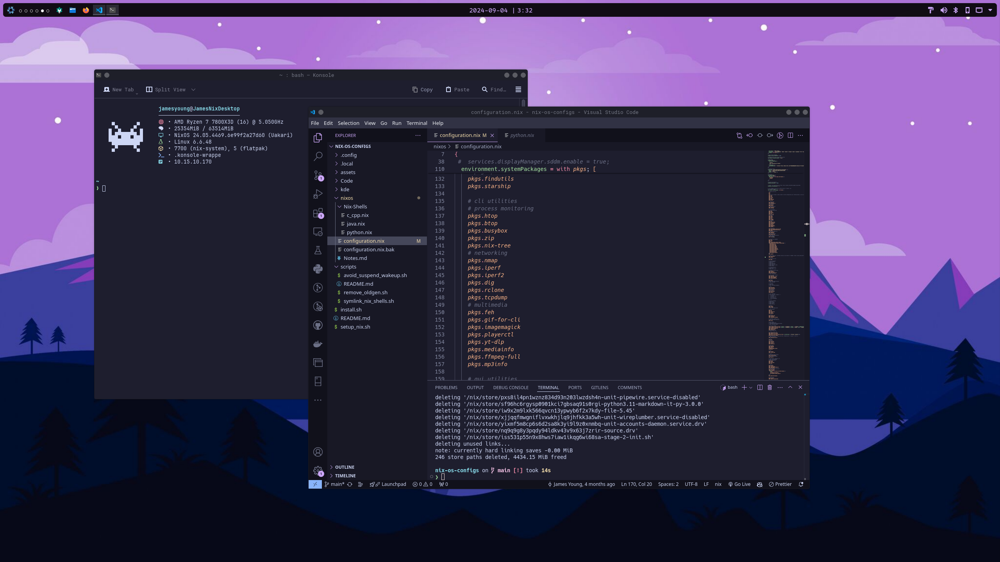
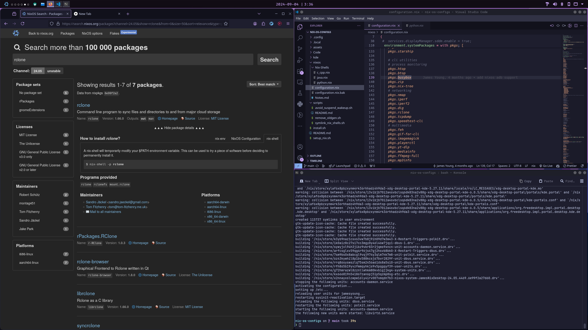
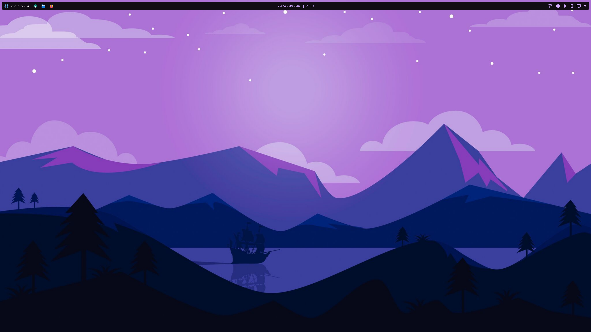

# James' Nix Config

My Nix config using Nix flakes and home manager. Currently use NixOS on my personal laptop and desktop, both using KDE Plasma 6 as DE.

## Preview

## Setup

See [docs/Setup.md](./docs/Setup.md).

## System Info

- OS: [NixOS](https://nixos.org/)
- Desktop Environment: [KDE Plamsa 6](https://nixos.wiki/wiki/KDE)
- Diplay Manager: SDDM
- Shell: Bash
- Terminal: [Konsole](https://konsole.kde.org/)
- Tiling: [Krohnkite](https://github.com/anametologin/krohnkite)
- Theme:
  - Global Theme: Breeze Dark
  - Colors: [Catppucin Mocha Lavender](https://github.com/catppuccin/kde)
  - Window Decoration: [Dracula](https://draculatheme.com/)
  - Icons: [Papirus Dark](https://github.com/vinceliuice/Tela-icon-theme)
  - Cursors: [Dracula Cursors](https://draculatheme.com/)
  - Wallpaper: See [here](./assets/PurpleMountain-Wallpaper.jpg)
- KDE Panel Widgets (left to right):
  - [Application Launcher](https://userbase.kde.org/Plasma_application_launchers)
  - [Desktop Indicator](https://store.kde.org/p/2131462)
  - [Icons-only Task Manager](https://userbase.kde.org/Plasma/Tasks/en)
  - [Digital Clock](https://userbase.kde.org/Plasma/Clocks/en)
  - [Panel Colorizer](https://store.kde.org/p/2130967)
  - [System Tray](https://userbase.kde.org/Plasma/SystemTray)
- Font: RobotoMono Nerd Font 10 pt

See my [fav application list](./docs/Fav-Applications-List.md) for more.

## Todos

- Reorganize modules to have more modularity for future hosts
- Improve organization of modules
- Move more global system packages to home manager (most don't need to be global)
- MacOS support in case I want/have to use Mac in future
- More dev shell templates (templates/) for work/dev
